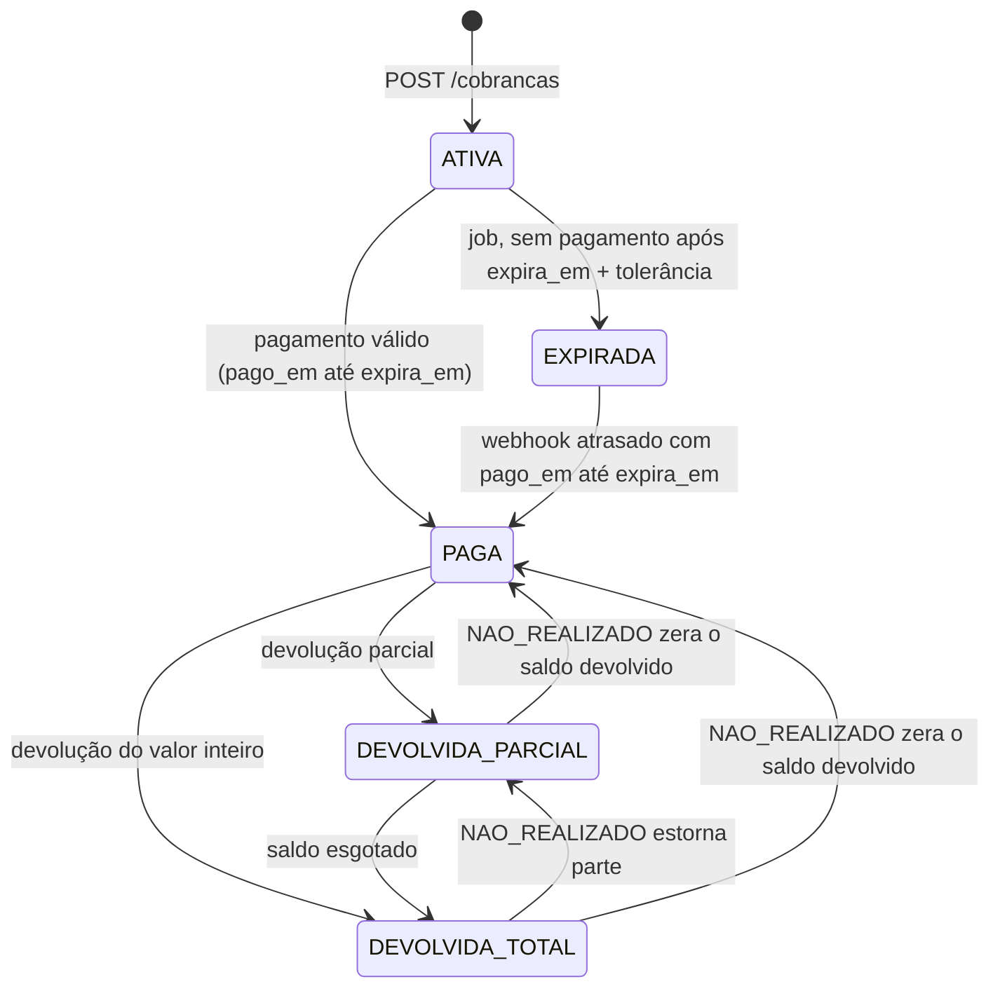
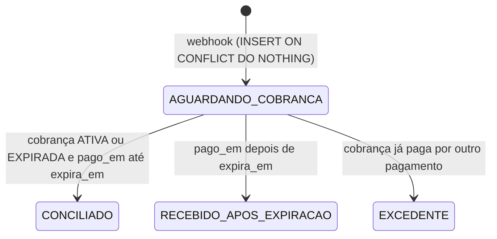
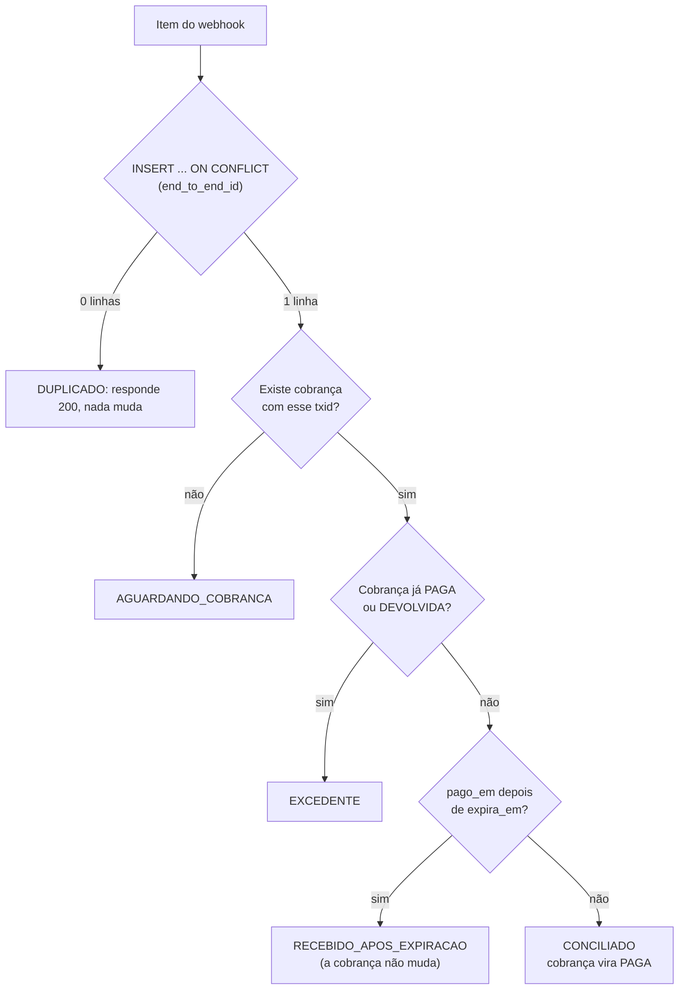
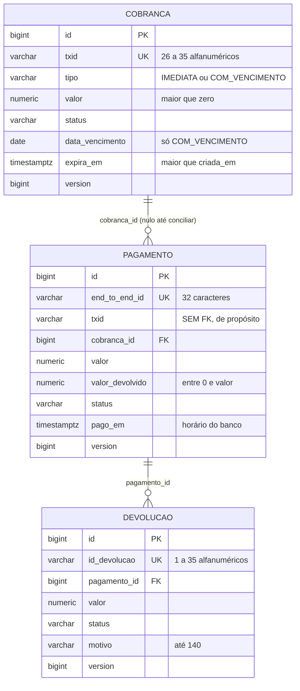

# PixGuard

Serviço de **cobranças Pix**: cria cobranças, recebe webhooks de pagamento e registra devoluções.

Java 21 · Spring Boot 3.5 · PostgreSQL 16 · Flyway · Testcontainers · Maven multi-módulo · Docker Compose

## A regra central

> Um pagamento recebido **nunca é baixado duas vezes** e **nunca fica esquecido como pendente**.

A garantia vem do **banco de dados** (constraints, índices únicos e operações atômicas). O código Java só trata
os desfechos: quando o banco recusa algo, ele sabe o que fazer. Exemplos: o mesmo webhook mil vezes vira uma única
linha (`UNIQUE` + `ON CONFLICT DO NOTHING`); dois pagamentos disputando a mesma cobrança não passam do índice único
parcial; duas devoluções simultâneas nunca passam do saldo (`UPDATE` condicional + `CHECK`).

## Módulos

| Módulo | O que é |
|---|---|
| `pixguard-api` | A aplicação (porta 8080): cobranças, webhook, job de reconciliação, devoluções |
| `mock-bank` | Banco simulado (porta 8081): dispara webhooks (normal, duplicado, atrasado, fora de ordem) e responde consultas. Não depende de nenhuma classe da API: só o contrato HTTP os liga |

## Ciclo de vida

### Cobrança



A validade de um pagamento se decide pelo **horário do pagamento informado pelo banco** (`pago_em`), nunca pela hora
em que o processamos. Por isso um webhook atrasado ainda baixa uma cobrança que o job já expirou.

### Pagamento



`AGUARDANDO_COBRANCA` só dura até a cobrança existir: ela é conciliada na criação da cobrança (mesma transação) ou,
se webhook e criação aconteceram ao mesmo tempo e nenhum viu o outro, pelo job. Os três desfechos finais representam
dinheiro que entrou e, portanto, são elegíveis a devolução.

### Processamento de um item do webhook



### Devolução

`EM_PROCESSAMENTO` → `DEVOLVIDO` ou `NAO_REALIZADO`. A devolução já conta no saldo enquanto está em processamento;
`NAO_REALIZADO` estorna o saldo

## Como rodar

**Pré-requisitos:** Java 21, Docker com Compose e Maven (só para gerar o wrapper uma vez).

```bash
# Uma vez, na raiz (gera mvnw e .mvn/; commite os dois):
mvn wrapper:wrapper -Dmaven=3.9.9

# Tudo com um comando: PostgreSQL + API + mock-bank (o Flyway aplica as migrações na subida)
docker compose up --build

curl localhost:8080/actuator/health     # {"status":"UP"}
```

Para desenvolver a API pelo IDE ou terminal, só o banco no Docker:

```bash
docker compose up db
./mvnw -pl pixguard-api spring-boot:run
./mvnw -pl mock-bank spring-boot:run     # opcional: banco simulado na 8081
```

### Demonstração: o webhook perdido

O banco recebe o pagamento, mas o webhook nunca chega. O job descobre pela consulta e baixa a cobrança.

```bash
# Prazos curtos só para a demonstração (os padrões são 1h / 30s / 1min):
PIXGUARD_COBRANCA_EXPIRACAOPADRAO=PT1M PIXGUARD_JOB_INTERVALO=PT10S PIXGUARD_JOB_TOLERANCIAEXPIRACAO=PT5S \
  docker compose up --build

# 1) cria uma cobrança e guarda o txid
TXID=$(curl -s -X POST localhost:8080/api/v1/cobrancas -H 'Content-Type: application/json' \
  -d '{"tipo":"IMEDIATA","valor":"110.00"}' | sed -E 's/.*"txid":"([^"]+)".*/\1/')

# 2) o banco registra o pagamento, mas o webhook só sai em 10 min (na prática, perdido)
curl -s -X POST localhost:8081/mock/pix/pagar -H 'Content-Type: application/json' \
  -d "{\"txid\":\"$TXID\",\"valor\":\"110.00\",\"modo\":\"ATRASADO\",\"atrasoMs\":600000}"

# 3) cerca de 1m15s depois, o job consulta o banco e baixa a cobrança
curl -s localhost:8080/api/v1/cobrancas/$TXID          # "status":"PAGA"
docker compose logs api | grep -E 'evento=(pagamento_baixado|job_ciclo_concluido)'
```

Outros cenários com o `mock-bank` (`POST /mock/pix/pagar`):

| `modo` | O que o banco simulado faz |
|---|---|
| `NORMAL` | um webhook, agora |
| `DUPLICADO` | o MESMO webhook (mesmo `endToEndId`) `copias` vezes |
| `ATRASADO` | registra o pagamento já, mas só envia o webhook depois de `atrasoMs` |
| `FORA_DE_ORDEM` | `copias` pagamentos distintos, entregues do mais recente para o mais antigo |

`GET /mock/cobrancas/{txid}` mostra o estado no banco; `DELETE /mock/pagamentos` zera tudo.

### Configuração

Tudo em `pixguard-api/src/main/resources/application.yml`; cada propriedade pode ser sobrescrita por variável de
ambiente (`pixguard.job.intervalo` vira `PIXGUARD_JOB_INTERVALO`; sem hífens: `PIXGUARD_JOB_TOLERANCIAEXPIRACAO`).
Valores de tempo aceitam `20ms`, `90d` ou ISO-8601 (`PT30S`).

| Propriedade | Padrão | Para quê |
|---|---|---|
| `pixguard.cobranca.expiracao-padrao` | `1h` | validade de uma cobrança IMEDIATA |
| `pixguard.cobranca.validade-apos-vencimento-dias` | `30` | COM_VENCIMENTO expira no fim do dia do vencimento + estes dias |
| `pixguard.cobranca.fuso-vencimento` | `America/Sao_Paulo` | fuso que decide o "dia" do vencimento |
| `pixguard.webhook.max-retentativas` | `3` | retentativas de um item que perdeu uma disputa de concorrência (0 desliga) |
| `pixguard.webhook.backoff-base` | `20ms` | espera base entre retentativas (cresce e ganha jitter) |
| `pixguard.devolucao.prazo` | `90d` | prazo para devolver, contado a partir de `pago_em` |
| `pixguard.job.habilitado` | `true` | liga/desliga o agendamento |
| `pixguard.job.intervalo` | `PT30S` | pausa entre ciclos do job |
| `pixguard.job.tamanho-lote` | `50` | itens por etapa em cada ciclo |
| `pixguard.job.tolerancia-expiracao` | `PT1M` | folga após `expira_em` antes de consultar o banco e expirar |
| `pixguard.banco.url` | `http://localhost:8081` | banco consultado pelo job |
| `pixguard.banco.timeout-conexao` / `timeout-leitura` | `PT2S` / `PT3S` | timeouts do cliente HTTP |
| `POSTGRES_PASSWORD` | `pixguard_dev` | senha do banco (padrão só para desenvolvimento local) |
| `mockbank.webhook` (mock-bank) | `http://localhost:8080/api/v1/webhooks/pix` | para onde o banco simulado envia webhooks |

## Como rodar os testes

```bash
./mvnw verify                      # os dois módulos; precisa do Docker rodando (Testcontainers)
./mvnw -pl pixguard-api verify     # só a API
./mvnw -pl mock-bank verify        # só o mock-bank (não precisa de Docker)
./mvnw -pl pixguard-api test -Dtest=DevolucaoApiTest

# Sem Docker: só os testes que não sobem banco
./mvnw -pl pixguard-api test -Dtest='CobrancaTest,PagamentoTest,DevolucaoTest,CobrancaDevolucaoTest,WebhookServiceTest,ConflitoDeConcorrenciaTest,ContextoLogTest,BancoClientRestTest,ConvencoesTest'
```

Os testes de integração usam **PostgreSQL 16 real via Testcontainers** (nunca H2), com **um container
compartilhado** por toda a suíte, banco limpo e relógio controlável (`Clock` injetado) a cada teste.
Para caçar flakiness nos testes com threads:

```bash
for i in 1 2 3 4 5; do ./mvnw -q -pl pixguard-api test -Dtest='WebhookConcorrenciaTest,DevolucaoApiTest' || break; done
```

São 203 métodos de teste em 23 classes (parametrizados contam como um), todos com `@DisplayName` em português.

| Grupo | Classes | O que provam |
|---|---|---|
| Domínio (sem Spring) | `CobrancaTest`, `PagamentoTest`, `DevolucaoTest`, `CobrancaDevolucaoTest` | invariantes, transições de estado válidas e inválidas |
| Constraints do banco | `CobrancaConstraintsTest`, `PagamentoConstraintsTest`, `DevolucaoConstraintsTest` | o BANCO recusa sozinho, com SQL puro, conferindo o nome da constraint violada |
| Mapeamento e migrações | `CobrancaRepositoryTest`, `MigracaoTest`, `BloqueioOtimistaTest` | JPA bate com o schema; V1 a V3 aplicam do zero; `@Version` nas três entidades |
| API | `CobrancaApiTest`, `WebhookPixApiTest`, `DevolucaoApiTest` | contratos HTTP, erros em `ProblemDetail`, idempotência, prazo, saldo |
| Job | `ReconciliacaoServiceTest`, `ReconciliacaoLoteTest`, `BancoClientRestTest` | expiração, consulta ao banco, falha isolada, `SKIP LOCKED`, timeouts |
| Concorrência | `WebhookConcorrenciaTest`, `WebhookRetentativaTest`, `WebhookServiceTest`, `ConflitoDeConcorrenciaTest` | threads liberadas por `CyclicBarrier`; retry determinístico na pilha real |
| Mock-bank | `MockBankApiTest` | os quatro modos de entrega |
| Convenções | `ConvencoesTest`, `ContextoLogTest` | a lista de proibições verificada a cada build; MDC sempre limpo |

Os testes de concorrência conferem o **banco** (`count(*)`, status, `version`), nunca só as respostas HTTP.

## API

| Método e caminho | O que faz | Respostas |
|---|---|---|
| `POST /api/v1/cobrancas` | cria cobrança IMEDIATA ou COM_VENCIMENTO | 201 + `Location` · 400 · 422 (vencimento no passado) |
| `GET /api/v1/cobrancas/{txid}` | consulta a cobrança | 200 · 404 |
| `POST /api/v1/webhooks/pix` | recebe pagamentos (formato do BCB) | 200 (processado **ou** duplicado) · 400 (payload malformado) · 503 (falha transitória: o banco reenvia) |
| `GET /api/v1/pagamentos/{endToEndId}` | consulta o pagamento e o saldo devolvido | 200 · 400 · 404 |
| `PUT /api/v1/pagamentos/{endToEndId}/devolucoes/{idDevolucao}` | pede uma devolução (idempotente pelo `idDevolucao`) | 201 criada · 200 repetição · 400 · 404 · 409 · 422 |
| `GET /api/v1/pagamentos/{endToEndId}/devolucoes/{idDevolucao}` | consulta a devolução | 200 · 404 |
| `GET /api/v1/pagamentos/{endToEndId}/devolucoes?pagina=0&tamanho=20` | lista paginada (máximo 100) | 200 · 404 |
| `PUT /api/v1/pagamentos/{endToEndId}/devolucoes/{idDevolucao}/resultado` | `DEVOLVIDO` ou `NAO_REALIZADO` (estorna o saldo) | 200 · 400 · 404 · 409 |

Dinheiro é sempre **string decimal com 2 casas** (`"110.00"`). Erros seguem a RFC 9457 (`application/problem+json`).
Códigos: **400** payload ou identificador inválido · **404** não encontrado · **409** conflito (mesmo `idDevolucao` com outro
valor, resultado contrário ao já registrado, disputa de concorrência) · **422** regra de negócio (saldo, prazo, vencimento).

```bash
# cobrança com vencimento
curl -i -X POST localhost:8080/api/v1/cobrancas -H 'Content-Type: application/json' \
  -d '{"tipo":"COM_VENCIMENTO","valor":"50.00","dataVencimento":"2026-12-10"}'

# webhook (formato do BCB)
curl -i -X POST localhost:8080/api/v1/webhooks/pix -H 'Content-Type: application/json' -d '{
  "pix":[{"endToEndId":"E00000000202611051200abcdef00001","txid":"<TXID>","valor":"110.00","horario":"2026-11-05T12:30:00Z"}]}'

# devolução parcial (o mesmo pedido de novo devolve 200 e NÃO debita outra vez)
curl -i -X PUT localhost:8080/api/v1/pagamentos/E00000000202611051200abcdef00001/devolucoes/dev001 \
  -H 'Content-Type: application/json' -d '{"valor":"40.00","motivo":"produto com defeito"}'
```

## Modelo de dados



Uma migração por mudança (`V1` cobrança, `V2` pagamento, `V3` devolução), nunca editada depois de aplicada.
Todo índice tem um comentário no SQL dizendo qual consulta ele atende.
Os índices que carregam a regra central:

- `uk_pagamento_end_to_end_id`: idempotência do webhook (alvo do `ON CONFLICT`).
- `uk_pagamento_cobranca_conciliado`: índice único **parcial**, no máximo um pagamento CONCILIADO por cobrança.
- `ck_pagamento_status_cobranca`: `AGUARDANDO_COBRANCA` se e somente se não há cobrança vinculada.
- `ck_pagamento_valor_devolvido`: `0 <= valor_devolvido <= valor`, a última linha de defesa das devoluções.
- `idx_cobranca_ativa_expira_em` e `idx_pagamento_aguardando_txid`: parciais, minúsculos em regime, atendem o job.

## Modelo de concorrência

Cada disputa possível tem uma proteção no BANCO; o código só decide o que fazer quando perde.

| Disputa | Quem garante | Resultado para quem perde |
|---|---|---|
| O mesmo webhook chega várias vezes ao mesmo tempo | `UNIQUE (end_to_end_id)` + `INSERT ... ON CONFLICT DO NOTHING` | espera a primeira transação e vira DUPLICADO (200) |
| Pagamentos diferentes disputam a mesma cobrança | índice único parcial `uk_pagamento_cobranca_conciliado` + `@Version` da cobrança | recebe erro de concorrência, é repetido e vira EXCEDENTE |
| Webhook e job sobre a mesma cobrança | `FOR UPDATE SKIP LOCKED` no job + `@Version` | o job ignora a linha travada; o webhook é repetido e vê o estado novo |
| Devoluções simultâneas do mesmo pagamento | `UPDATE` condicional do saldo + `CHECK` | 422 (saldo insuficiente) |
| Resultados simultâneos da mesma devolução | `PESSIMISTIC_WRITE` na devolução | o segundo vê o resultado já registrado (200) |
| Webhook e criação da cobrança ao mesmo tempo, sem ver um ao outro | job (rede de segurança) | conciliado no próximo ciclo |

**Retry (webhook).** `WebhookService` é uma fachada SEM transação que chama `PagamentoService.processar`, outro bean
transacional. Se uma tentativa perde a disputa, ela é refeita do zero numa transação nova, até 3 vezes além da primeira,
com backoff de 20 ms crescente e com jitter. Só se repete o que é conflito de concorrência (`ConcurrencyFailureException`:
conflito de `@Version`, deadlock, falha de lock; e a violação do índice `uk_pagamento_cobranca_conciliado`). Qualquer outro erro
não é repetido. Esgotadas as tentativas, a resposta é 503 e o reenvio do banco, idempotente, resolve. Fora do webhook, uma
disputa que escape vira 409.

## Decisões de design

Decisões que a especificação não previa, e por que foram tomadas assim.

### Dados e domínio

- **Constraints primeiro.** Toda invariante expressável como constraint está na migração, mesmo que o domínio Java também
  valide. O domínio falha cedo com mensagem clara; o banco é a última linha de defesa.
- **Valor com mais de 2 casas é rejeitado, não arredondado** (`RoundingMode.UNNECESSARY`). Arredondar dinheiro em silêncio
  esconde bug de quem chama a API.
- **Enums como `VARCHAR` + `CHECK`**, não como `ENUM` nativo do PostgreSQL: trocar um `CHECK` é uma migração comum, alterar
  um `ENUM` nativo é mais restrito.
- **`atualizada_em` é NOT NULL** e nasce igual a `criada_em`. Evita tratar nulo em toda leitura.
- **Entidades sem setters**, com construtor protegido, `equals`/`hashCode` pela chave de negócio e transições como métodos
  do domínio que lançam exceção em transição inválida. `Pagamento.aguardandoCobranca` e `Devolucao.solicitar` existem para
  testes e fixtures: em produção essas linhas são inseridas por SQL nativo (`ON CONFLICT`), que é o que garante a idempotência.
- **`valor_devolvido` é somente leitura na entidade.** O saldo só muda por `UPDATE` atômico no banco.
- **`Devolucao.pagamento` é EAGER de propósito:** a resposta mostra o `endToEndId` e o controller a monta depois que a
  transação termina (open-in-view desligado). É um único pagamento por consulta.
- **O valor no JSON é string decimal validada por regex** (`"110.00"`: exatamente 2 casas, maior que zero). `110`, `110.5`,
  `"1e2"` e `"110,00"` são 400.

### Cobrança

- **A criação só aceita `tipo`, `valor` e `dataVencimento`.** O prazo da cobrança imediata vem da configuração, não do cliente:
  menos superfície, menos validação.
- **"Fim do dia do vencimento" é o início do dia seguinte** (limite exclusivo), calculado em data local no fuso
  `America/Sao_Paulo`. Um pagamento exatamente à meia-noite ainda é considerado dentro do prazo.
- **Vencimento no passado é 422**, não 400: o payload está bem formado, a data é que não serve. "Hoje" é decidido no fuso de
  São Paulo, não em UTC.
- **`GET` devolve o status gravado.** Uma cobrança ATIVA com `expira_em` no passado continua ATIVA até o job expirá-la: há um
  único caminho de expiração.
- **`GeradorTxid` é uma interface** para os testes escolherem o txid e simularem "webhook antes da cobrança".

### Webhook e conciliação

- **400 para a requisição inteira se QUALQUER item for malformado, e nada é processado.** Payload malformado é erro de quem
  envia, não falha transitória. Itens bem formados são independentes entre si.
- **Falha em um item: os demais são processados e a resposta é 503.** O banco reenvia; os itens já processados voltam como
  duplicados e são ignorados. É a idempotência que torna o reenvio seguro.
- **A decisão de desfecho existe num lugar só** (`Conciliador`), usado pelo webhook, pela criação de cobrança e pelo job.
  Por isso há um único caminho de baixa.
- **Pagamento com cobrança já PAGA ou DEVOLVIDA vira EXCEDENTE**; fica vinculado à cobrança e elegível a devolução.
- **Pago após `expira_em` com a cobrança ainda ATIVA:** o pagamento vira RECEBIDO_APOS_EXPIRACAO e a cobrança não muda.
  Quem expira cobranças é o job; o webhook não toma essa decisão.
- **Vários pagamentos esperando a mesma cobrança:** ao criá-la, vale o mais antigo por `pago_em`, com desempate pelo id; os
  demais viram EXCEDENTE.
- **Com a cobrança já criada, quem decide é a ordem de processamento:** o primeiro pagamento processado vence, mesmo que o
  banco o tenha feito depois de outro (é a regra da especificação). Mas um pagamento válido que chega depois de um pago fora do
  prazo ainda é baixado, porque a validade é do `pago_em`, não da ordem de chegada.
- **O valor do pagamento não é comparado ao da cobrança.** Numa cobrança Pix o valor é imposto pelo banco do pagador. Se isso
  mudar, a comparação entra no `Conciliador`.
- **`txid` é obrigatório no item do webhook.** Pix sem cobrança associada está fora do escopo.

### Job de reconciliação

- **"Sem retorno" = `expira_em` + tolerância (padrão 1 min).** É exatamente o que o índice parcial `idx_cobranca_ativa_expira_em`
  atende. Consequência assumida: um webhook perdido de uma cobrança ainda válida só é descoberto depois do prazo, e mesmo assim
  o pagamento é baixado, porque a validade vem do `pago_em`. Detectar antes exigiria registrar a última consulta (nova coluna).
- **O lock `FOR UPDATE SKIP LOCKED` é por cobrança, na transação de cada item, não por lote.** Um lock de lote seguraria as
  linhas enquanto cada item abre outra transação e travaria o próprio job. A lista de candidatas é uma leitura simples; cada
  item relê a linha travando-a e desiste se outro processo já a pegou ou se ela deixou de ser ATIVA/vencida.
- **A consulta ao banco (HTTP) acontece FORA da transação**, para nenhum lock de linha ficar preso durante uma chamada de rede.
- **Banco que falha (rede, timeout, 4xx/5xx, resposta inválida, 404) nunca altera estado.** O 404 é falha, não "não paga": URL
  errada ou banco que não conhece a cobrança não pode expirar cobranças em massa.
- **Cobrança paga segundo o banco passa por `PagamentoService.processar`, o mesmo do webhook.** Se o pagamento já era conhecido,
  vira DUPLICADO. Se a cobrança continua ATIVA depois disso (sem pagamento, ou pago após o prazo), expira.
- **Dentro de um ciclo, pagamentos aguardando rodam antes das cobranças sem retorno:** é a etapa barata e pode resolver
  cobranças sem consultar o banco.
- **Item com falha é desfeito sozinho e o lote continua.** Limitação conhecida: itens que falham sempre ficam no começo da fila
  e ocupam espaço no lote a cada ciclo (ver "Limitações").
- **Durações em ISO-8601 (`PT30S`) no YAML do job**, formato que o `@Scheduled` aceita sem ambiguidade. O agendamento liga e
  desliga por `pixguard.job.habilitado`; os testes desligam e chamam o serviço direto.
- **mock-bank:** qualquer `txid` sem pagamento registrado é ATIVA (o banco "conhece" todas as cobranças). `atrasoMs` só vale em
  ATRASADO; `copias` só em DUPLICADO e FORA_DE_ORDEM (padrão 2). O banco registra o pagamento na hora, mesmo que o webhook saia
  depois: é o que cria o cenário de webhook perdido.

### Devoluções

- **O saldo é do banco.** `UPDATE pagamento SET valor_devolvido = valor_devolvido + :v ... WHERE id = :id AND valor_devolvido + :v <= valor`.
  O PostgreSQL reavalia a condição depois de esperar um UPDATE concorrente na mesma linha, então devoluções simultâneas nunca
  estouram o saldo. Zero linhas afetadas vira 422 e o rollback desfaz a devolução inserida.
- **Repetição é respondida antes das regras de prazo e saldo** (a especificação lista o prazo primeiro). Ordem real: pagamento
  existe, `INSERT ... ON CONFLICT DO NOTHING`, e só para pedido NOVO: elegibilidade, prazo e saldo. Reenviar um pedido que já
  deu certo nunca vira erro por o prazo ter passado nesse meio tempo.
- **Mesmo `idDevolucao`: só é repetição se o valor E o pagamento forem os mesmos.** Senão é 409. Criação devolve 201; repetição
  devolve 200 com a devolução existente.
- **O prazo conta do `pago_em`**, com limite inclusivo, e é configurável.
- **Quem pode ser devolvido:** CONCILIADO, RECEBIDO_APOS_EXPIRACAO e EXCEDENTE. AGUARDANDO_COBRANCA não: se a cobrança
  aparecesse depois, seria baixada por um pagamento já devolvido em parte.
- **Só o pagamento que baixou a cobrança (CONCILIADO) altera o status dela.** O status é sempre derivado do saldo devolvido
  (PAGA, DEVOLVIDA_PARCIAL, DEVOLVIDA_TOTAL). Devolver um EXCEDENTE ou um RECEBIDO_APOS_EXPIRACAO não muda a cobrança.
- **A cobrança só é carregada depois do `UPDATE` atômico do saldo.** Duas devoluções parciais simultâneas se serializam na linha
  do pagamento; a segunda lê a cobrança já atualizada pela primeira e não há conflito de `@Version`.
- **Resultado da devolução** (`PUT .../resultado`): `NAO_REALIZADO` estorna o saldo por `UPDATE` atômico e recalcula a cobrança.
  Repetir o mesmo resultado é inofensivo; o contrário do já registrado é 409. A devolução é travada (`PESSIMISTIC_WRITE`) durante o
  registro, então resultados simultâneos estornam uma única vez. Esse endpoint faz o papel do callback do banco: nada move uma
  devolução de EM_PROCESSAMENTO sozinho.
- **`motivo` é o motivo do pedido** (opcional, até 140 caracteres). Nunca é logado: é texto livre e pode conter dado pessoal.
- **Identificadores de caminho são validados no controller** e viram 400. Preferi isso a `@Pattern` em parâmetro de caminho
  porque, com validação de método, o corpo `@Valid` passaria a gerar outro tipo de exceção e perderíamos a lista de erros por
  campo do `ProblemDetail`.
- **A listagem é paginada com ordenação fixa por id** e tamanho máximo 100: não aceitamos `sort` do cliente para não expor colunas
  internas. A resposta é um `PaginaResponse`, não o `Page` do Spring (o JSON dele não é um contrato estável).
- **O saldo devolvível é o `valor` do pagamento**, que é o dinheiro que de fato entrou, e não o da cobrança.

### Concorrência

- **"Retry até 3x" = 3 retentativas depois da primeira tentativa** (4 execuções no máximo). Configurável; 0 desliga.
- **A violação do índice de baixa única também é retentável.** Com o `@Version` sozinho, o perdedor da disputa nem sempre falha
  por conflito de versão: a ordem do flush do Hibernate (pagamento antes da cobrança) faz o banco recusar primeiro pelo índice
  único. As duas falhas significam "outro ganhou, repita": na repetição o pagamento vira EXCEDENTE. Não repetimos outras violações
  de constraint, que seriam dado inválido ou bug. Reproduzido no nível de SQL num PostgreSQL 16 real, na ordem de comandos que o
  Hibernate emite: com 6 pagamentos disputando a mesma cobrança, todos os perdedores falharam com
  `uk_pagamento_cobranca_conciliado`. O `WebhookConcorrenciaTest` exercita o mesmo cenário pela pilha Java completa.
- **Backoff com jitter:** threads que colidiram não repetem em compasso.
- **Devoluções e criação de cobrança não têm retry.** As devoluções se serializam pela linha do pagamento e a criação não
  disputa linhas. Se uma disputa escapar, vira 409 e o cliente repete.
- **O retry é testado de dois jeitos:** de forma determinística (um spy simula o conflito na pilha real) e com threads de verdade.

### Operação

- **Logs estruturados:** `txid` e `endToEndId` entram no MDC (`MDC.putCloseable`, sempre limpo, inclusive em contextos aninhados) em
  webhook, job e devolução. Mensagens com nome de evento estável (`evento=pagamento_baixado`, `pagamento_duplicado`,
  `pagamento_aguardando_cobranca`, `pagamento_apos_expiracao`, `pagamento_excedente`, `devolucao_registrada`, entre outros). JSON
  no container (perfil `docker`), legível no local.
- **O Dockerfile usa a imagem `maven:3.9-eclipse-temurin-21`** no estágio de build, sem depender do wrapper dentro do container.
  O wrapper continua sendo o caminho para rodar localmente.
- **Senha do banco com padrão de desenvolvimento** (`pixguard_dev`) em `docker-compose.yml` e `application.yml`, sobrescrevível por
  `POSTGRES_PASSWORD`. É valor de dev local, sem uso fora dele.
- **As convenções são testes** (`ConvencoesTest`) e rodam no CI a cada push (`.github/workflows/ci.yml`).

## Estrutura

```
pixguard/
├── pom.xml                         pai: Spring Boot 3.5, Java 21, módulos
├── docker-compose.yml              db + api + mock-bank
├── .github/workflows/ci.yml        ./mvnw verify em cada push
├── pixguard-api/
│   ├── Dockerfile
│   └── src/main/java/br/com/pixguard/
│       ├── controller/             CobrancaController, WebhookPixController, PagamentoController
│       ├── service/                CobrancaService, PagamentoService, WebhookService (retry), Conciliador,
│       │                           ReconciliacaoService, ExpiracaoCobrancaService, DevolucaoService, ContextoLog
│       ├── repository/             Spring Data + consultas nativas (ON CONFLICT, SKIP LOCKED, UPDATE atômico)
│       ├── domain/                 Cobranca, Pagamento, Devolucao e enums de status (sem setters)
│       ├── dto/                    records de entrada e saída (a entidade nunca sai pela API)
│       ├── client/                 BancoClient (interface) e BancoClientRest (RestClient com timeouts)
│       ├── job/                    ReconciliacaoJob (só agenda)
│       ├── exception/              exceções de negócio e TratadorDeErros (ProblemDetail)
│       └── config/                 @ConfigurationProperties, Clock, agendamento
│   └── src/main/resources/db/migration/   V1 cobrança · V2 pagamento · V3 devolução
└── mock-bank/                      banco simulado, sem dependência da API
```

## O que é proibido (e verificado em `ConvencoesTest`)

H2 nos testes · Lombok · `double`/`float` para dinheiro · entidade exposta na API · `@Transactional` em controller (ou na fachada
do webhook) · `Instant.now()` direto (o tempo vem do `Clock` injetado) · `catch` vazio · log com dado pessoal · editar migração já
aplicada (o `MigracaoTest` valida o histórico do Flyway contra os arquivos) · commit gigante.

## Limitações conhecidas

- **Sem autenticação** (o escopo exclui Spring Security): o webhook não verifica a origem. Em produção, o BCB usa mTLS e a lista de
  IPs do PSP deve ser restringida na borda.
- **Itens que falham sempre ocupam o começo da fila do job.** Um contador de tentativas (nova coluna) resolveria.
- **Webhook perdido só é detectado depois do prazo** (`expira_em` + tolerância). Detectar antes pediria registrar a última consulta.
- **O valor do pagamento não é comparado ao da cobrança** (ver decisões).
- **Pix sem `txid` está fora do escopo.**
- **Devolução EM_PROCESSAMENTO não avança sozinha:** o desfecho entra pelo endpoint `resultado`, que faz o papel do callback do banco.
- **Pagamento AGUARDANDO_COBRANCA não pode ser devolvido.**
- **O estado do mock-bank é em memória.**
- **Só logs estruturados:** sem métricas nem tracing.
- **Os testes com threads dependem de timing.** Foram escritos para convergir no mesmo estado final em qualquer ordem de execução,
  mas vale repeti-los (ver o laço acima) ao mudar algo de concorrência.

## Próximos passos

Contador de tentativas no job · coluna de última consulta para detectar webhook perdido antes do prazo · métricas (Micrometer) e
tracing · verificação de origem do webhook (mTLS) · notificação do recebedor por padrão outbox · validação do valor do pagamento
contra o da cobrança, se o negócio exigir.
# pixguard

